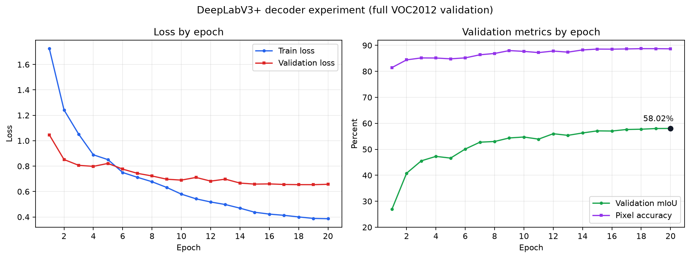

# 第11章　DeepLabV3+式浅层特征融合实验

## 11.1 实验目的

上一阶段的完整错误分析显示，当前DeepLabV3-MobileNetV3模型对自行车、盆栽等细长结构存在明显漏检，且深层特征直接上采样难以恢复局部空间信息。本实验在保持数据划分、输入尺寸、预训练骨干、损失函数、优化器和训练预算不变的条件下，将原DeepLabV3分类头替换为DeepLabV3+式浅层特征融合解码器，检验解码器结构本身的贡献。

公平的主要对照是 `highres_dice_01`，因为两组都冻结MobileNetV3骨干并训练20轮。此前的 `finetune_gpu_02` 额外解冻骨干最后3块并增加10轮微调，只用于判断新模型是否刷新当前全局最佳，不能作为隔离解码器贡献的唯一对照。

## 11.2 模型结构与实验配置

新模型从MobileNetV3第3块取得24通道、输出步长4的浅层特征，从最终块取得960通道、输出步长16的深层特征。深层特征经过ASPP后上采样至浅层尺度；浅层特征通过1×1卷积投影到48通道，再与深层特征拼接，通过两层3×3卷积生成21类预测。

| 项目 | 设置 |
|---|---|
| 实验目录 | `experiments/deeplabv3plus_decoder_01` |
| 模型 | DeepLabV3+式解码器 + MobileNetV3-Large |
| 骨干初始化 | ImageNet预训练 |
| 骨干训练状态 | 全部冻结 |
| 输入尺寸 | 384×384 |
| batch size | 4 |
| 损失函数 | Cross Entropy + Dice Loss，Dice权重1.0 |
| 优化器 | AdamW，权重衰减0.01 |
| 学习率 | 0.001，余弦退火至0.00001 |
| 训练轮数 | 20 |
| 随机种子 | 42 |
| 计算设备 | NVIDIA GeForce RTX 4080 SUPER |
| 软件环境 | Python 3.12.3，PyTorch 2.8.0+cu128，Torchvision 0.23.0+cu128 |

全部20轮均处理完整1464张训练图和1449张验证图，`partial_run=False`。累计训练与验证耗时约905.88秒，即15分05.88秒。

## 11.3 逐轮结果与最佳模型

| 轮次 | 训练loss | 验证loss | 验证mIoU | 像素准确率 |
|---:|---:|---:|---:|---:|
| 1 | 1.7246 | 1.0457 | 26.91% | 81.44% |
| 5 | 0.8509 | 0.8214 | 46.61% | 84.81% |
| 10 | 0.5797 | 0.6900 | 54.72% | 87.68% |
| 15 | 0.4372 | 0.6585 | 57.09% | 88.56% |
| 17 | 0.4129 | 0.6558 | 57.62% | 88.62% |
| 18 | 0.4001 | 0.6542 | 57.72% | 88.72% |
| 19 | 0.3886 | **0.6540** | 57.99% | **88.71%** |
| **20** | **0.3860** | 0.6570 | **58.02%** | 88.67% |

第20轮取得最佳验证mIoU `0.5802384623`，即58.02%；第19轮验证loss最低且像素准确率略高，但本作业以mIoU选模，因此应使用第20轮 `best.pth`。`best.pth` 和 `last.pth` 均记录第20轮与同一个最佳mIoU。



*图11-1　左图为20轮训练与验证loss，右图为完整验证集mIoU和像素准确率。图中使用原始逐轮日志，未进行平滑处理。*

第19到20轮mIoU只增加约0.04个百分点，同时验证loss略有回升，学习率已降至约`1.61e-5`。结果支持保留第20轮最佳权重，但不支持继续用同一冻结骨干配置盲目增加轮数。

## 11.4 与已有实验的总体对比

| 实验 | 解码器 | 骨干状态 | 最佳mIoU | 像素准确率 | 相对变化 |
|---|---|---|---:|---:|---:|
| `highres_dice_01` | DeepLabV3 | 全冻结 | 55.68% | 87.77% | 公平结构基线 |
| `finetune_gpu_02` | DeepLabV3 | 微调最后3块 | 56.84% | 88.20% | 此前全局最佳 |
| `deeplabv3plus_decoder_01` | 浅层融合解码器 | 全冻结 | **58.02%** | **88.67%** | 比结构基线+2.34个百分点；比此前最佳+1.19个百分点 |

新解码器在骨干仍完全冻结的情况下超过已微调骨干的旧模型，说明提升不能解释为额外骨干训练。与严格控制变量的 `highres_dice_01` 相比，mIoU提高约2.34个百分点，像素准确率提高约0.89个百分点，支持浅层特征融合有效。

## 11.5 逐类IoU变化

| 类别 | `highres_dice_01` | 新解码器 | 变化（百分点） | 与此前微调最佳相比 |
|---|---:|---:|---:|---:|
| 背景 | 87.28% | 88.54% | +1.25 | +0.78 |
| 飞机 | 62.74% | 67.17% | +4.44 | +3.62 |
| 自行车 | 29.48% | **42.00%** | **+12.52** | **+11.83** |
| 鸟 | 64.14% | 67.43% | +3.29 | +0.52 |
| 船 | 53.98% | 56.22% | +2.24 | -1.04 |
| 瓶子 | 54.99% | 55.66% | +0.67 | -0.67 |
| 公交车 | 75.03% | 76.57% | +1.53 | +1.00 |
| 汽车 | 64.77% | 67.07% | +2.30 | +1.00 |
| 猫 | 69.89% | 71.24% | +1.35 | +0.43 |
| 椅子 | 16.55% | 17.72% | +1.17 | -1.44 |
| 牛 | 58.46% | 60.92% | +2.46 | +1.15 |
| 餐桌 | 39.88% | 43.47% | +3.59 | +4.49 |
| 狗 | 63.24% | 63.22% | -0.02 | -0.91 |
| 马 | 52.09% | 55.31% | +3.23 | +1.72 |
| 摩托车 | 63.04% | 65.84% | +2.80 | +2.98 |
| 人 | 67.91% | 69.06% | +1.15 | +0.79 |
| 盆栽 | 34.63% | 34.96% | +0.33 | -0.33 |
| 羊 | 63.04% | 65.09% | +2.05 | +0.33 |
| 沙发 | 32.77% | 32.16% | -0.62 | -1.91 |
| 火车 | 64.91% | 67.50% | +2.59 | +0.69 |
| 电视显示器 | 50.51% | 51.35% | +0.84 | -0.13 |

相对冻结骨干的公平基线，21类中19类提升，只有狗下降0.02、沙发下降0.62个百分点。自行车提高12.52个百分点，是本实验最重要的逐类证据，符合浅层高分辨率特征有助于车轮和细杆结构恢复的预期。飞机、餐桌、鸟、马和摩托车也有较明显提升。

但是，椅子和盆栽只小幅提高，沙发反而下降；与此前微调最佳相比，椅子、沙发、盆栽仍未改善。这说明浅层融合解决了部分空间细节问题，但不能单独解决椅子/沙发语义混淆。下一节使用完整逐图错误分析进一步区分IoU、precision、recall和完全漏检比例的变化。

## 11.6 完整验证集错误分析

使用第20轮 `best.pth` 对全部1449张验证图重新推理，得到mIoU 58.0238%、像素准确率88.6669%，与训练日志逐位一致；`partial_analysis=false`。下表与旧结构微调最佳 `finetune_gpu_02` 的完整错误分析采用相同统计口径。

| 类别 | 旧IoU | 新IoU | 旧Precision→新Precision | 旧Recall→新Recall | 完全漏检比例 | 图片级Recall中位数 |
|---|---:|---:|---:|---:|---:|---:|
| 椅子 | 19.16% | 17.72% | 31.51%→30.48% | 32.84%→29.75% | 33.33%→34.15% | 14.69%→5.90% |
| 自行车 | 30.17% | **42.00%** | 37.48%→48.42% | 60.71%→76.00% | 20.25%→15.19% | 54.05%→77.11% |
| 沙发 | 34.06% | 32.16% | 51.54%→44.97% | 50.11%→53.02% | 12.22%→7.78% | 49.17%→54.94% |
| 盆栽 | 35.29% | 34.96% | 56.46%→46.06% | 48.49%→59.20% | 45.88%→25.88% | 5.92%→22.74% |

自行车的precision和recall同时提高，完全漏检比例下降5.06个百分点，图片级recall中位数提高23.06个百分点，说明浅层融合对自行车不是简单扩大预测区域，而是同时改善了检出和区域质量。

盆栽完全漏检比例下降20个百分点，沙发下降4.44个百分点，两类的recall和图片级中位数均提高，说明模型更容易找到目标。但是它们的precision下降，导致IoU没有同步提高：模型找回了更多真实前景，也把更多邻近像素误判为该类。这是“召回提高、区域变松”的典型权衡。

椅子是明确的未解决项：precision、recall、IoU和图片级recall中位数均下降，完全漏检比例略升。新解码器提供的局部细节不足以解决椅子与人物、沙发和背景之间的语义判别。


*图11-2　自行车总体显著改善，但复杂遮挡和多目标场景中仍可能完全漏检。*


*图11-3　人物主体能够识别，但承载人物的椅子区域没有正确预测，反映语义判别仍不足。*

本节最差样本是按recall和IoU有意筛选的失败案例，不代表类别平均表现；比例结论来自完整 `sample_class_metrics.csv`，不能只用展示图片推断。

## 11.7 结论与下一步实验

阶段A达到预设进入条件：总体mIoU提高，19个类别相对公平基线提升，而且没有出现大范围类别退化。因此下一步按原计划进行阶段B：从本实验第20轮 `best.pth` 初始化，解冻MobileNetV3最后3块，以较小骨干学习率微调10轮。

```bash
python train_baseline.py --device cuda --architecture deeplabv3plus --backbone mobilenet_v3_large --freeze-backbone --unfreeze-last-blocks 3 --init-from experiments/deeplabv3plus_decoder_01/best.pth --image-size 384 --batch-size 4 --lr 0.0001 --backbone-lr 0.00001 --lr-scheduler cosine --min-lr 0.000001 --loss ce_dice --dice-weight 1.0 --epochs 10 --log-every 20 --output-dir experiments/deeplabv3plus_finetune_01
```

阶段B的主要对照应是本实验58.02%，而不是旧模型56.84%。若阶段B没有超过58.02%，最终测试推理仍使用本实验的 `best.pth`。除总mIoU外，阶段B还应检查椅子IoU和图片级recall是否恢复、盆栽和沙发precision是否回升，并确保自行车IoU不明显回退。不建议先继续冻结骨干增加轮数，因为后两轮增益很小、学习率已接近下限；也不建议同时加入类别权重，否则无法判断微调骨干的独立贡献。

为减少手工输入参数造成的错误，项目新增 `run_deeplabv3plus_finetune.py`。启动器会验证来源checkpoint必须是384输入、CE+Dice的DeepLabV3+-MobileNetV3模型，并固定本节的实验参数。先在GPU执行冒烟检查：

```bash
python run_deeplabv3plus_finetune.py --device cuda --smoke
```

冒烟检查只处理1个训练batch和1张验证图，强制添加 `--no-checkpoints`，不能作为实验成绩。成功后运行正式实验：

```bash
python run_deeplabv3plus_finetune.py --device cuda
```

本地已使用真实第20轮checkpoint完成启动器检查，确认只解冻骨干块14、15、16，并跑通参数更新和验证；19项自动化测试通过。

本实验的完整错误分析已经完成，结果目录为 `error_analysis/deeplabv3plus_decoder_01_error`。阶段B完成后应使用相同参数再次运行错误分析，输出到新的 `error_analysis/deeplabv3plus_finetune_01` 目录：

```bash
python analyze_validation_errors.py --device cuda --checkpoint experiments/deeplabv3plus_finetune_01/best.pth --target-classes chair,bicycle,sofa,pottedplant --samples-per-class 8 --output-dir error_analysis/deeplabv3plus_finetune_01
```

阶段B重点与本节的新基线比较：椅子34.15%、自行车15.19%、沙发7.78%、盆栽25.88%的完全漏检比例，以及四类precision/recall变化。该错误分析用于解释机制，不替代以完整验证集mIoU选择最终模型。

## 11.8 证据文件

- `experiments/deeplabv3plus_decoder_01/config.json`：模型、环境和超参数。
- `metrics.csv`：20轮完整训练与验证结果。
- `best_per_class_iou.json`：第20轮21类IoU。
- `best.pth`、`last.pth`：均记录第20轮；正式选模使用 `best.pth`。
- `command.txt`、`command_history.txt`：实际运行命令。
- `tensorboard/`：训练过程事件文件。
- `report_sections/assets/deeplabv3plus_decoder_01_curves.png`：由原始 `metrics.csv` 生成的20轮曲线图。
- `error_analysis/deeplabv3plus_decoder_01_error/`：完整验证集混淆矩阵、逐类指标、逐图指标和32张失败案例图。
- `run_deeplabv3plus_finetune.py`：阶段B来源校验、冒烟检查和正式训练启动器。

## 11.9 阶段B骨干后段微调结果与收尾计划

阶段B已完成10轮完整训练。每轮均使用1464张训练图和1449张验证图，`partial_run=False`。第10轮取得最佳mIoU 58.99%、像素准确率89.27%，验证loss 0.6431；相对阶段A的58.02%提高约0.96个百分点。累计耗时约584.82秒。

| 对比项 | 阶段A冻结骨干 | 阶段B微调后 | 变化（百分点） |
|---|---:|---:|---:|
| 总体mIoU | 58.02% | **58.99%** | **+0.96** |
| 自行车IoU | 42.00% | 44.86% | +2.86 |
| 椅子IoU | 17.72% | 18.65% | +0.92 |
| 盆栽IoU | 34.96% | 37.70% | +2.74 |
| 沙发IoU | 32.16% | 34.20% | +2.04 |

21类中18类提升；船、瓶子和餐桌分别下降0.92、0.29和0.72个百分点。弱类别均有改善，说明小学习率微调最后3个骨干块有效。第8轮mIoU为58.94%，第9轮回落至58.60%，第10轮回升并刷新最佳；同时第10轮验证loss也是最低值。因此结果尚不能断定完全进入平台，但原10轮余弦调度器已运行结束，checkpoint中的学习率降至`1e-6`。直接使用 `--resume --epochs 20` 会恢复`T_max=10`的调度器并使余弦学习率重新上升，不是合理的10–20轮延长方案。

下一步只进行5轮独立低学习率收尾，而不是再训练10–20轮。新阶段从第10轮最佳模型参数初始化，但重建优化器和5轮余弦调度：分割头`1e-5`、骨干`1e-6`、最低学习率`1e-7`。项目新增 `run_deeplabv3plus_polish.py` 固定并校验这些参数。

```bash
python run_deeplabv3plus_polish.py --device cuda --smoke
python run_deeplabv3plus_polish.py --device cuda
```

正式输出目录为 `experiments/deeplabv3plus_polish_01`。若5轮最佳mIoU没有超过58.99%，最终模型仍使用 `deeplabv3plus_finetune_01/best.pth`；若提高，则使用收尾实验的 `best.pth`，随后对最终权重运行完整错误分析和400张测试集推理。本地已用真实58.99% checkpoint完成1个训练batch和1张验证图的冒烟检查，确认只解冻块14、15、16；22项自动化测试通过。
