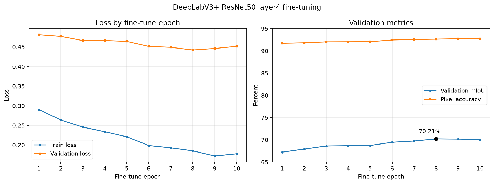

# 第12章　低学习率收尾与DeepLabV3+ ResNet50实验结果

## 12.1 收尾实验目的与设置

`deeplabv3plus_finetune_01` 第10轮取得58.99%的最佳验证mIoU，且最佳值出现在末轮。为判断当前MobileNetV3方案是否仍有低学习率收益，本实验从该最佳权重开始，重建优化器并进行5轮独立收尾训练，而不是恢复已结束的10轮余弦调度器。

| 项目 | 设置 |
|---|---|
| 实验目录 | `experiments/deeplabv3plus_polish_01` |
| 初始化权重 | `deeplabv3plus_finetune_01/best.pth` |
| 可训练部分 | DeepLabV3+解码器、MobileNetV3最后3块 |
| 解码器学习率 | `1e-5` |
| 骨干学习率 | `1e-6` |
| 最低学习率 | `1e-7` |
| 调度器 | 新建5轮余弦退火 |
| 其他设置 | 384×384、batch 4、CE+Dice、完整VOC2012 train/val |

全部5轮均完整处理1464张训练图和1449张验证图，`partial_run=False`。

## 12.2 逐轮结果

| 轮次 | 训练loss | 验证loss | 验证mIoU | 像素准确率 |
|---:|---:|---:|---:|---:|
| 1 | 0.2993 | 0.6473 | 58.72% | 89.05% |
| 2 | 0.2931 | 0.6506 | 58.90% | 89.10% |
| **3** | 0.2845 | 0.6511 | **58.92%** | 89.19% |
| 4 | 0.2735 | 0.6517 | 58.73% | 89.10% |
| 5 | 0.2841 | 0.6501 | 58.81% | **89.26%** |

收尾阶段最佳mIoU为58.9242%，出现在第3轮，低于来源模型的58.9871%，差约0.06个百分点。训练loss继续下降，但验证mIoU没有刷新，后两轮也未恢复到来源模型水平，说明继续优化训练目标没有转化为更好的验证集类别平均IoU。

## 12.3 逐类变化与最终选模

相对 `deeplabv3plus_finetune_01`，收尾最佳权重只有8类提高、13类下降。椅子提高0.25、船提高0.82、电视显示器提高0.71个百分点，但自行车下降0.19、盆栽下降0.54、沙发下降0.65个百分点。局部类别收益不足以抵消总体退化。

因此当前MobileNetV3路线停止继续训练，最终保留：

```text
experiments/deeplabv3plus_finetune_01/best.pth
验证mIoU：58.9871%
像素准确率：89.2671%
```

不使用 `deeplabv3plus_polish_01/best.pth` 作为最终模型，也不再增加相同配置的训练轮数。

## 12.4 DeepLabV3+ ResNet50实验结果

MobileNetV3收尾无效只说明原骨干与训练设置进入平台，并不代表更强模型没有空间。本实验保留已经验证有效的DeepLabV3+解码器，只将ImageNet预训练骨干从MobileNetV3-Large替换为ResNet50：

| 项目 | MobileNet对照 | ResNet50新实验 |
|---|---|---|
| 解码器 | DeepLabV3+式浅层融合 | 相同 |
| 骨干 | MobileNetV3-Large | ResNet50 |
| 骨干状态 | 全冻结 | 全冻结 |
| 浅层特征 | 24通道，输出步长4 | 256通道，输出步长4 |
| 深层特征 | 960通道，输出步长16 | 2048通道，输出步长16 |
| 输入/损失/轮数 | 384、CE+Dice、20轮 | 相同 |

新模型约4035万参数，MobileNet版本约1173万参数。实际实验在RTX 4080 SUPER上以batch size 4完成，无需降低batch size。全部20轮均完整处理1464张训练图和1449张验证图，`partial_run=False`；累计训练与验证约1117.23秒，即18分37.23秒。

实际运行命令为：

```bash
python train_baseline.py --device cuda --architecture deeplabv3plus --backbone resnet50 --freeze-backbone --image-size 384 --batch-size 4 --lr 0.001 --lr-scheduler cosine --min-lr 0.00001 --loss ce_dice --dice-weight 1.0 --epochs 20 --log-every 20 --output-dir experiments/deeplabv3plus_resnet50_01
```

关键轮次结果如下：

| 轮次 | 训练loss | 验证loss | 验证mIoU | 像素准确率 |
|---:|---:|---:|---:|---:|
| 1 | 1.4990 | 0.8888 | 40.58% | 84.06% |
| 6 | 0.6163 | 0.5560 | 62.49% | 90.40% |
| 11 | 0.4114 | 0.5173 | 65.56% | 90.76% |
| 13 | 0.3561 | 0.4766 | 67.69% | 91.88% |
| 16 | 0.3113 | **0.4678** | 68.45% | 91.99% |
| **18** | **0.2844** | 0.4709 | **68.48%** | **92.07%** |
| 20 | 0.2704 | 0.4735 | 68.41% | 91.93% |

第18轮取得最佳验证mIoU `0.6847567989`，即68.48%，像素准确率92.07%。第16轮验证loss最低，但本作业按mIoU选择模型，因此使用第18轮 `best.pth`，不能使用第20轮 `last.pth`。第18轮之后mIoU略回落，说明冻结骨干方案在20轮附近已经进入平台。


*图12-1　20轮原始训练日志曲线。左图为训练与验证loss，右图为完整验证集mIoU和像素准确率；未进行平滑处理。*

## 12.5 与MobileNetV3路线的对比

| 对比项 | MobileNet冻结骨干 | MobileNet微调最佳 | ResNet50冻结骨干 |
|---|---:|---:|---:|
| 验证mIoU | 58.02% | 58.99% | **68.48%** |
| 像素准确率 | 88.67% | 89.27% | **92.07%** |
| ResNet50相对提升 | +10.45个百分点 | +9.49个百分点 | — |

ResNet50在骨干完全冻结的条件下已经显著超过微调后的MobileNetV3，说明模型容量和预训练特征表达是此前的主要瓶颈。相对MobileNet全局最佳，21类IoU全部提高：马、牛、狗、汽车、飞机分别提高18.41、16.30、15.81、13.29、13.28个百分点；自行车提高9.23、盆栽提高9.78、沙发提高4.60个百分点。椅子仍是最低类别，但也从18.65%提高到21.05%。提升不是由少数类别或背景单独造成。

## 12.6 下一步实验：只微调ResNet50 layer4

冻结ResNet50已经取得明显收益，下一步只解冻最后的`layer4`，其他骨干层和BatchNorm运行统计保持冻结。这样可以让最高层语义特征适应VOC2012，同时控制过拟合和实验变量。建议从第18轮 `best.pth` 初始化，分割头学习率`1e-4`、`layer4`学习率`1e-5`，训练10轮，主要对照为68.48%。

```bash
python train_baseline.py --device cuda --architecture deeplabv3plus --backbone resnet50 --freeze-backbone --unfreeze-last-blocks 1 --init-from experiments/deeplabv3plus_resnet50_01/best.pth --image-size 384 --batch-size 4 --lr 0.0001 --backbone-lr 0.00001 --lr-scheduler cosine --min-lr 0.000001 --loss ce_dice --dice-weight 1.0 --epochs 10 --log-every 20 --output-dir experiments/deeplabv3plus_resnet50_finetune_01
```

正式微调前应先用独立目录跑1个训练batch和1张验证图。若微调结果未超过68.48%，最终模型继续使用冻结骨干实验第18轮 `best.pth`。微调完成后应对最佳权重运行完整错误分析，重点检查椅子、沙发、盆栽和自行车，而不能只看总体mIoU。

## 12.7 后续边界

若ResNet50的`layer4`微调仍不能带来有意义提升，再考虑DINOv3+PSP式分割头。参考项目在不同实现和训练条件下得到81.73%，该数字不能作为本项目保证值。DINOv3路线需要单独准备受许可的预训练权重、Transformer特征提取和新的训练配置，工程成本明显更高。

## 12.8 证据与代码

- `experiments/deeplabv3plus_polish_01/metrics.csv`：5轮完整日志。
- `best_per_class_iou.json`：收尾第3轮逐类IoU。
- `config.json`、`command_history.txt`：实际环境与命令。
- `src/model.py`：DeepLabV3+ ResNet50模型实现。
- `run_deeplabv3plus_resnet50.py`：冒烟和正式实验启动器。
- `tests/test_deeplabv3plus_resnet50.py`、`tests/test_resnet50_runner.py`：结构与命令测试。
- `experiments/deeplabv3plus_resnet50_01/`：20轮配置、日志、最佳与末轮权重和逐类IoU。
- `report_sections/assets/deeplabv3plus_resnet50_01_curves.png`：由原始 `metrics.csv` 生成的训练曲线。

## 12.9 ResNet50 layer4微调结果

从冻结骨干实验第18轮 `best.pth` 初始化，只解冻ResNet50的 `layer4`，其余骨干层和BatchNorm运行统计保持冻结。分割头学习率为 `1e-4`，`layer4` 学习率为 `1e-5`，使用10轮余弦退火。10轮均完整处理1464张训练图和1449张验证图，`partial_run=False`，累计耗时约544.99秒。

| 微调轮次 | 训练loss | 验证loss | 验证mIoU | 像素准确率 |
|---:|---:|---:|---:|---:|
| 1 | 0.2904 | 0.4811 | 67.23% | 91.71% |
| 3 | 0.2458 | 0.4661 | 68.62% | 92.03% |
| 5 | 0.2209 | 0.4641 | 68.74% | 92.07% |
| 6 | 0.1988 | 0.4513 | 69.45% | 92.45% |
| 7 | 0.1929 | 0.4490 | 69.73% | 92.55% |
| **8** | **0.1853** | **0.4421** | **70.21%** | 92.64% |
| 9 | 0.1721 | 0.4460 | 70.17% | 92.73% |
| 10 | 0.1777 | 0.4514 | 70.04% | **92.75%** |

第8轮同时取得最高mIoU和最低验证loss，最佳mIoU为 `0.7020652608`，即70.21%。第9、10轮mIoU轻微回落，因此正式模型应使用第8轮 `best.pth`，不能使用第10轮 `last.pth`。相对冻结ResNet50的68.48%，微调提高约1.73个百分点；相对MobileNetV3全局最佳58.99%，提高约11.22个百分点。



*图12-2　ResNet50 layer4微调的原始逐轮loss、mIoU和像素准确率，未进行平滑处理。*

逐类对比显示21类中18类提高，3类下降。提升较明显的类别包括电视显示器+5.28、椅子+3.73、羊+3.41、飞机+3.31、沙发+2.64、盆栽+2.57个百分点；自行车、狗和摩托车分别下降1.19、0.49和0.64个百分点。椅子仍是最低类别，但从21.05%提高到24.78%。微调改善了多数类别和弱类别，不是只提高背景。

当前全局最佳权重更新为：

```text
experiments/deeplabv3plus_resnet50_finetune_01/best.pth
验证mIoU：70.2065%
像素准确率：92.6359%
最佳微调轮次：8
```

第8轮后已出现轻微回落，不建议继续增加相同配置的训练轮数。下一步先对该最终候选权重运行完整错误分析，再决定是否值得进入成本更高的DINOv3路线；课程作业交付则可直接进入400张测试图推理。

错误分析命令：

```bash
python analyze_validation_errors.py --device cuda --checkpoint experiments/deeplabv3plus_resnet50_finetune_01/best.pth --target-classes chair,bicycle,sofa,pottedplant --samples-per-class 8 --output-dir error_analysis/deeplabv3plus_resnet50_finetune_01
```

新增证据：

- `experiments/deeplabv3plus_resnet50_finetune_01/`：10轮配置、日志、权重和逐类IoU。
- `report_sections/assets/deeplabv3plus_resnet50_finetune_01_curves.png`：微调曲线。

## 12.10 最终候选权重错误分析

使用第8轮最佳权重对全部1449张验证图重新推理，得到mIoU 70.2065%、像素准确率92.6359%，与训练日志一致，`partial_analysis=false`。

| 类别 | IoU | Precision | Recall | 完全漏检图片比例 | 图片级Recall中位数 |
|---|---:|---:|---:|---:|---:|
| 椅子 | 24.78% | 45.36% | 35.32% | 24.39% | 16.95% |
| 沙发 | 41.44% | 60.38% | 56.92% | 7.78% | 60.29% |
| 盆栽 | 50.05% | 66.70% | 66.71% | 15.29% | 51.21% |
| 自行车 | 52.89% | 57.88% | 86.00% | 8.86% | 85.67% |

椅子仍是最主要瓶颈：precision和recall同时偏低，123张含椅子验证图中30张完全漏检，错误主要流向背景，其次是沙发和人物。自行车recall已达到86%，但precision只有57.88%，说明模型通常能找到目标，却容易把人物、车辆或背景并入自行车区域；直接增加自行车类别权重可能进一步增加假阳性。盆栽和沙发仍存在整目标漏检，但整体precision/recall相对均衡。

错误分析结果位于 `error_analysis/resnet50_finetune_error_analysis/`，包含完整混淆矩阵、逐类指标、逐图指标和32张失败案例图。当前模型在第8轮后已经回落，不再延长相同训练配置。

## 12.11 多尺度水平翻转TTA实验

本实验不修改模型参数，分别以0.75、1.0、1.25倍输入尺度推理，并对原图和水平翻转图的原始尺寸logits求平均。每张验证图共6次前向。完整评估覆盖全部1449张验证图片，`partial_analysis=false`。

GPU冒烟检查：

```bash
python evaluate_tta.py --device cuda --checkpoint experiments/deeplabv3plus_resnet50_finetune_01/best.pth --scales 0.75,1.0,1.25 --max-images 2 --output-dir evaluations/resnet50_finetune_tta_smoke
```

实际完整验证集命令为：

```bash
python evaluate_tta.py --device cuda --checkpoint experiments/deeplabv3plus_resnet50_finetune_01/best.pth --scales 0.75,1.0,1.25 --output-dir evaluations/resnet50_finetune_tta_01
```

### 12.11.1 总体结果

| 推理方式 | 验证mIoU | 像素准确率 | 每图前向次数 |
|---|---:|---:|---:|
| 单尺度384、无TTA | 70.2065% | 92.6359% | 1 |
| 0.75/1.0/1.25尺度 + 水平翻转 | **72.1406%** | **93.3299%** | 6 |
| TTA变化 | **+1.9340个百分点** | **+0.6940个百分点** | 推理成本约6倍 |

TTA使21个类别IoU全部提高，没有类别退化，因此提升具有一致性，不是少数类别或背景单独拉动。TTA不产生新checkpoint：模型权重仍是第8轮 `best.pth`，72.14%应表述为“该权重使用多尺度水平翻转TTA后的验证结果”，不能写成训练模型单尺度成绩。

### 12.11.2 边界损失对照实验

本实验从70.21%的第8轮权重初始化，仅将CE+Dice改为边界加权CE+Dice。标签类别变化处向外扩张3像素，边界交叉熵权重设为2，忽略标签255不参与损失。其余配置与layer4微调基线相同，训练5轮。

```bash
python run_boundary_loss.py --device cuda --smoke
python run_boundary_loss.py --device cuda
```

正式结果保存在 `experiments/resnet50_boundary_loss_01/`。最佳为第3轮，mIoU 70.2088%、像素准确率92.7621%；标准单尺度基线为70.2065%、92.6359%。mIoU仅差+0.0023个百分点，实际持平。

边界损失权重运行相同三尺度翻转TTA后得到72.0503%、像素准确率93.3980%；标准模型TTA为72.1406%、93.3299%。边界TTA的mIoU低0.0902个百分点。边界损失单尺度有12类提高、8类下降、1类近似不变；边界TTA相对标准TTA有12类提高、9类下降，摩托车、盆栽和椅子退化较明显。因此不采用边界损失方案，也不继续搜索边界宽度和权重；最终保留标准CE+Dice权重及标准TTA推理。

### 12.11.3 标准TTA逐类变化

| 类别 | 单尺度IoU | TTA IoU | 变化（百分点） |
|---|---:|---:|---:|
| 椅子 | 24.78% | 26.83% | +2.05 |
| 自行车 | 52.89% | 54.80% | +1.91 |
| 沙发 | 41.44% | 44.20% | +2.75 |
| 盆栽 | 50.05% | 51.63% | +1.58 |
| 船 | 65.06% | 68.81% | +3.75 |
| 瓶子 | 61.71% | 64.92% | +3.21 |
| 电视显示器 | 62.96% | 65.78% | +2.82 |

提升最大的类别是船（+3.75）、瓶子（+3.21）、电视显示器（+2.82）和沙发（+2.75）。“椅子”仍是最低类别，但也提高2.05个百分点；这说明多尺度融合能缓解尺度和边界误差，却没有根除椅子与背景、沙发和人物之间的语义混淆。

### 12.11.4 结论与使用边界

完整TTA结果有效，应作为当前最高验证推理方案。课程测试集推理建议使用同一组尺度和翻转策略，然后只保存融合后argmax得到的单通道类别掩码。由于测试集无标签，不能宣称测试集mIoU；最终报告应同时列出70.21%的单尺度模型成绩与72.14%的TTA验证成绩，并注明TTA约增加6倍推理计算量。

证据文件位于 `evaluations/resnet50_finetune_tta_01/`：`summary.json`记录完整配置和总体指标，`class_metrics.csv`记录21类TTA IoU及相对单尺度变化。

## 12.12 512×512微调实验（已完成）

当前训练预处理已包含随机缩放、随机裁剪和同步水平翻转。下一项只提高输入尺寸至512×512，从70.21%的第8轮最佳权重初始化，仍只训练ResNet50 layer4和分割头，使用标准CE+Dice，不再叠加边界权重。目标是保留更多椅子、盆栽和自行车的空间细节。

先运行batch 4冒烟检查：

```bash
python train_baseline.py --device cuda --architecture deeplabv3plus --backbone resnet50 --freeze-backbone --unfreeze-last-blocks 1 --init-from experiments/deeplabv3plus_resnet50_finetune_01/best.pth --image-size 512 --batch-size 4 --lr 0.0001 --backbone-lr 0.00001 --lr-scheduler cosine --min-lr 0.000001 --loss ce_dice --dice-weight 1.0 --epochs 1 --max-train-batches 1 --max-val-batches 1 --no-checkpoints --output-dir experiments/resnet50_512_smoke
```

该实验已经完成。10轮均完整处理1464张训练图和1449张验证图，partial_run=False。

```bash
python train_baseline.py --device cuda --architecture deeplabv3plus --backbone resnet50 --freeze-backbone --unfreeze-last-blocks 1 --init-from experiments/deeplabv3plus_resnet50_finetune_01/best.pth --image-size 512 --batch-size 4 --lr 0.0001 --backbone-lr 0.00001 --lr-scheduler cosine --min-lr 0.000001 --loss ce_dice --dice-weight 1.0 --epochs 10 --log-every 20 --output-dir experiments/resnet50_512_finetune_01
```

最佳为第9轮，mIoU 70.5315%、像素准确率92.9704%，相对384输入单尺度70.2065%提高0.3248个百分点。第10轮回落至70.12%，因此选第9轮best.pth。

21类中12类提升、9类下降。自行车从52.89%升至59.40%（+6.51个百分点），椅子从24.78%升至27.17%（+2.39）；牛、马、摩托车分别下降3.26、3.38、2.33个百分点。512输入有小幅总体收益，但类别间存在权衡，尚未超过384输入TTA的72.14%。

已对512最佳权重运行多尺度翻转TTA。checkpoint基础尺寸为512，因此三个尺度对应384、512、640像素：

```bash
python evaluate_tta.py --device cuda --checkpoint experiments/resnet50_512_finetune_01/best.pth --scales 0.75,1.0,1.25 --output-dir evaluations/resnet50_512_tta_01
```

完整评估覆盖1449张验证图，`partial_analysis=false`。TTA mIoU为**72.6513%**，像素准确率为**93.6479%**；相对512单尺度70.5315%提高2.1198个百分点，相对384多尺度翻转TTA的72.1406%再提高0.5107个百分点。这是当前最高验证推理成绩。

21类中20类相对512单尺度提升，椅子下降约0.58个百分点；提升较明显的类别包括瓶子+4.42、牛+3.45、船+3.57、电视显示器+2.97个百分点。总体收益为正，但椅子仍是弱类，不能说所有类别都改善。

TTA不产生新模型权重。单尺度ResNet50权重仍为`experiments/resnet50_512_finetune_01/best.pth`（70.53%）；72.65%是该权重采用0.75/1.0/1.25尺度与水平翻转、融合logits后的验证结果。下一步停止新增训练实验，把同一TTA融合流程接入400张测试图预测，再检查掩码格式和打包提交。
