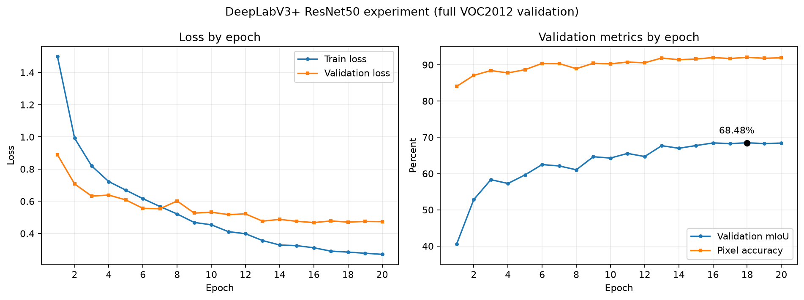

# 第12章　低学习率收尾与DeepLabV3+ ResNet50实验结果

## 12.1 收尾实验目的与设置

`deeplabv3plus_finetune_01` 第10轮取得58.99%的最佳验证mIoU，且最佳值出现在末轮。为判断当前MobileNetV3方案是否仍有低学习率收益，本实验从该最佳权重开始，重建优化器并进行5轮独立收尾训练，而不是恢复已结束的10轮余弦调度器。

| 项目 | 设置 |
|---|---|
| 实验目录 | `experiments/deeplabv3plus_polish_01` |
| 初始化权重 | `deeplabv3plus_finetune_01/best.pth` |
| 可训练部分 | DeepLabV3+解码器、MobileNetV3最后3块 |
| 解码器学习率 | `1e-5` |
| 骨干学习率 | `1e-6` |
| 最低学习率 | `1e-7` |
| 调度器 | 新建5轮余弦退火 |
| 其他设置 | 384×384、batch 4、CE+Dice、完整VOC2012 train/val |

全部5轮均完整处理1464张训练图和1449张验证图，`partial_run=False`。

## 12.2 逐轮结果

| 轮次 | 训练loss | 验证loss | 验证mIoU | 像素准确率 |
|---:|---:|---:|---:|---:|
| 1 | 0.2993 | 0.6473 | 58.72% | 89.05% |
| 2 | 0.2931 | 0.6506 | 58.90% | 89.10% |
| **3** | 0.2845 | 0.6511 | **58.92%** | 89.19% |
| 4 | 0.2735 | 0.6517 | 58.73% | 89.10% |
| 5 | 0.2841 | 0.6501 | 58.81% | **89.26%** |

收尾阶段最佳mIoU为58.9242%，出现在第3轮，低于来源模型的58.9871%，差约0.06个百分点。训练loss继续下降，但验证mIoU没有刷新，后两轮也未恢复到来源模型水平，说明继续优化训练目标没有转化为更好的验证集类别平均IoU。

## 12.3 逐类变化与最终选模

相对 `deeplabv3plus_finetune_01`，收尾最佳权重只有8类提高、13类下降。椅子提高0.25、船提高0.82、电视显示器提高0.71个百分点，但自行车下降0.19、盆栽下降0.54、沙发下降0.65个百分点。局部类别收益不足以抵消总体退化。

因此当前MobileNetV3路线停止继续训练，最终保留：

```text
experiments/deeplabv3plus_finetune_01/best.pth
验证mIoU：58.9871%
像素准确率：89.2671%
```

不使用 `deeplabv3plus_polish_01/best.pth` 作为最终模型，也不再增加相同配置的训练轮数。

## 12.4 DeepLabV3+ ResNet50实验结果

MobileNetV3收尾无效只说明原骨干与训练设置进入平台，并不代表更强模型没有空间。本实验保留已经验证有效的DeepLabV3+解码器，只将ImageNet预训练骨干从MobileNetV3-Large替换为ResNet50：

| 项目 | MobileNet对照 | ResNet50新实验 |
|---|---|---|
| 解码器 | DeepLabV3+式浅层融合 | 相同 |
| 骨干 | MobileNetV3-Large | ResNet50 |
| 骨干状态 | 全冻结 | 全冻结 |
| 浅层特征 | 24通道，输出步长4 | 256通道，输出步长4 |
| 深层特征 | 960通道，输出步长16 | 2048通道，输出步长16 |
| 输入/损失/轮数 | 384、CE+Dice、20轮 | 相同 |

新模型约4035万参数，MobileNet版本约1173万参数。实际实验在RTX 4080 SUPER上以batch size 4完成，无需降低batch size。全部20轮均完整处理1464张训练图和1449张验证图，`partial_run=False`；累计训练与验证约1117.23秒，即18分37.23秒。

实际运行命令为：

```bash
python train_baseline.py --device cuda --architecture deeplabv3plus --backbone resnet50 --freeze-backbone --image-size 384 --batch-size 4 --lr 0.001 --lr-scheduler cosine --min-lr 0.00001 --loss ce_dice --dice-weight 1.0 --epochs 20 --log-every 20 --output-dir experiments/deeplabv3plus_resnet50_01
```

关键轮次结果如下：

| 轮次 | 训练loss | 验证loss | 验证mIoU | 像素准确率 |
|---:|---:|---:|---:|---:|
| 1 | 1.4990 | 0.8888 | 40.58% | 84.06% |
| 6 | 0.6163 | 0.5560 | 62.49% | 90.40% |
| 11 | 0.4114 | 0.5173 | 65.56% | 90.76% |
| 13 | 0.3561 | 0.4766 | 67.69% | 91.88% |
| 16 | 0.3113 | **0.4678** | 68.45% | 91.99% |
| **18** | **0.2844** | 0.4709 | **68.48%** | **92.07%** |
| 20 | 0.2704 | 0.4735 | 68.41% | 91.93% |

第18轮取得最佳验证mIoU `0.6847567989`，即68.48%，像素准确率92.07%。第16轮验证loss最低，但本作业按mIoU选择模型，因此使用第18轮 `best.pth`，不能使用第20轮 `last.pth`。第18轮之后mIoU略回落，说明冻结骨干方案在20轮附近已经进入平台。



*图12-1　20轮原始训练日志曲线。左图为训练与验证loss，右图为完整验证集mIoU和像素准确率；未进行平滑处理。*

## 12.5 与MobileNetV3路线的对比

| 对比项 | MobileNet冻结骨干 | MobileNet微调最佳 | ResNet50冻结骨干 |
|---|---:|---:|---:|
| 验证mIoU | 58.02% | 58.99% | **68.48%** |
| 像素准确率 | 88.67% | 89.27% | **92.07%** |
| ResNet50相对提升 | +10.45个百分点 | +9.49个百分点 | — |

ResNet50在骨干完全冻结的条件下已经显著超过微调后的MobileNetV3，说明模型容量和预训练特征表达是此前的主要瓶颈。相对MobileNet全局最佳，21类IoU全部提高：马、牛、狗、汽车、飞机分别提高18.41、16.30、15.81、13.29、13.28个百分点；自行车提高9.23、盆栽提高9.78、沙发提高4.60个百分点。椅子仍是最低类别，但也从18.65%提高到21.05%。提升不是由少数类别或背景单独造成。

## 12.6 下一步实验：只微调ResNet50 layer4

冻结ResNet50已经取得明显收益，下一步只解冻最后的`layer4`，其他骨干层和BatchNorm运行统计保持冻结。这样可以让最高层语义特征适应VOC2012，同时控制过拟合和实验变量。建议从第18轮 `best.pth` 初始化，分割头学习率`1e-4`、`layer4`学习率`1e-5`，训练10轮，主要对照为68.48%。

```bash
python train_baseline.py --device cuda --architecture deeplabv3plus --backbone resnet50 --freeze-backbone --unfreeze-last-blocks 1 --init-from experiments/deeplabv3plus_resnet50_01/best.pth --image-size 384 --batch-size 4 --lr 0.0001 --backbone-lr 0.00001 --lr-scheduler cosine --min-lr 0.000001 --loss ce_dice --dice-weight 1.0 --epochs 10 --log-every 20 --output-dir experiments/deeplabv3plus_resnet50_finetune_01
```

正式微调前应先用独立目录跑1个训练batch和1张验证图。若微调结果未超过68.48%，最终模型继续使用冻结骨干实验第18轮 `best.pth`。微调完成后应对最佳权重运行完整错误分析，重点检查椅子、沙发、盆栽和自行车，而不能只看总体mIoU。

## 12.7 后续边界

若ResNet50的`layer4`微调仍不能带来有意义提升，再考虑DINOv3+PSP式分割头。参考项目在不同实现和训练条件下得到81.73%，该数字不能作为本项目保证值。DINOv3路线需要单独准备受许可的预训练权重、Transformer特征提取和新的训练配置，工程成本明显更高。

## 12.8 证据与代码

- `experiments/deeplabv3plus_polish_01/metrics.csv`：5轮完整日志。
- `best_per_class_iou.json`：收尾第3轮逐类IoU。
- `config.json`、`command_history.txt`：实际环境与命令。
- `src/model.py`：DeepLabV3+ ResNet50模型实现。
- `run_deeplabv3plus_resnet50.py`：冒烟和正式实验启动器。
- `tests/test_deeplabv3plus_resnet50.py`、`tests/test_resnet50_runner.py`：结构与命令测试。
- `experiments/deeplabv3plus_resnet50_01/`：20轮配置、日志、最佳与末轮权重和逐类IoU。
- `report_sections/assets/deeplabv3plus_resnet50_01_curves.png`：由原始 `metrics.csv` 生成的训练曲线。
